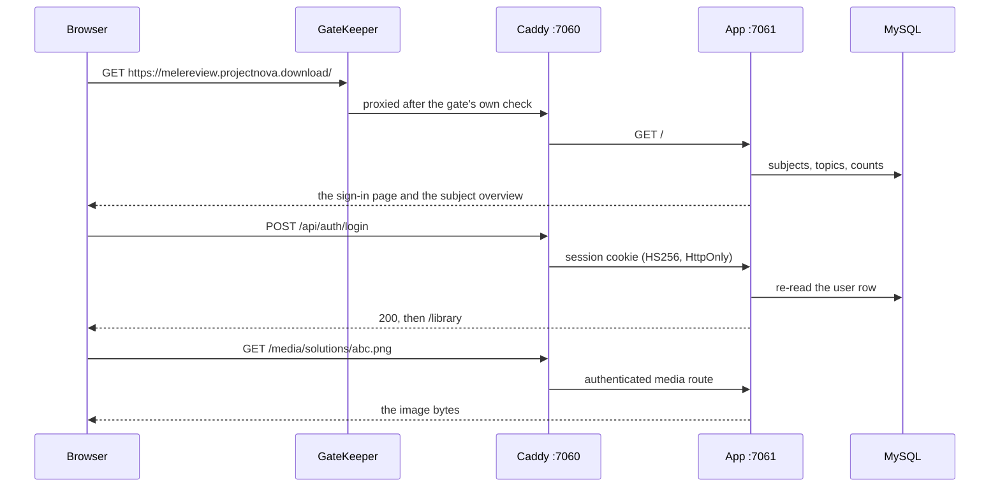

# Architecture

One FastAPI app behind one Caddy, one MySQL container, and one documentation container. The
previous build split an API service from a web service and carried a gRPC server nothing called;
both are gone.

## Process layout

```text
melereview_caddy :7060   loopback publish, on the shared gatekeeper network
  /health                -> melereview_main:7061
  /api/*                 -> melereview_main:7061
  /media/*               -> melereview_main:7061
  /tools/*               -> melereview_main:7061
  /static/*              -> melereview_main:7061, cached for a year
  /documentation/*       -> melereview_documentation:8005, prefix stripped
  everything else        -> melereview_main:7061

melereview_main :7061    FastAPI + Granian, one worker, uid 10001
melereview_db   :3306    MySQL 8.4, volume mysql_data
melereview_documentation :8005   MkDocs build served by its own FastAPI app
uploads_data             volume, mounted at /app/uploads
```

## Request flow



The app re-reads the `users` row on every request. That is the whole reason a ban takes effect on
the next request while the cookie is still valid.

## Layout

```
app/
  __init__.py      create_app(), lifespan, middleware
  config.py        pydantic-settings, env from compose
  db.py            async engine, session factory
  models.py        SQLAlchemy 2.0 tables
  schemas.py       request bodies
  security.py      scrypt, session tokens, CSRF, invite codes
  permissions.py   the eight bit flags
  auth.py          current_user, require_user, require_admin, CSRF check
  bootstrap.py     legacy reset, schema, seed, administrator
  cache.py         Cache-Control middleware
  errors.py        request id, error pages, JSON envelopes
  media.py         upload validation, storage, path resolution
  templating.py    Jinja environment and the render helper
  services/        users, invites, library
  routes/          pages, auth, invites, library, media, admin, tools
  thermo/          CoolProp cycle solver and plot geometry
  templates/       Jinja2, extending the shared shell
  static/          main.css, tool.css, compiled Tailwind, page JS, calculators, Plotly
mysql/seed/        taxonomy.sql
caddy/             Caddyfile and its Dockerfile
documentation/     MkDocs sources
```

## Schema work at startup

There is no migration tool. `app/bootstrap.py` runs four steps on every boot and each is
idempotent:

| Step | Behaviour |
|---|---|
| `reset_legacy_schema` | Drops the retired tables only when `users` is absent |
| `create_schema` | `create_all` for missing tables, `ADD COLUMN` for missing columns, `FOREIGN_KEY_CHECKS=0` around the batch on MySQL |
| `seed_taxonomy` | Executes the guarded SQL file; safe to re-run |
| `ensure_system_admin` | Creates or reconciles the administrator from `ADMIN_USER` / `ADMIN_PASS` |

Retries the schema step ten times at three-second intervals, so a MySQL container that is still
starting does not fail the boot.

## Auth boundary

| Concern | Where it lives |
|---|---|
| Who is signed in | `app/auth.py` `current_user`, from the session cookie |
| Can they do this bit | `app/permissions.py` `require`, plus `require_admin` for `/admin` |
| Is their content public | `app/services/library.py`, one filter: not hidden and author active |
| Cross-site request forgery | `app/auth.py` `check_csrf`, called by every mutating route |
| Rate limits | `app/limiter.py`, five per minute on sign-in and registration |

GateKeeper is independent of all of this. It decides whether a visitor reaches the site at all; the
app decides what that visitor may do once they are here.

## Networks

```yaml
networks:
  default:
  gatekeeper:
    external: true
    name: gatekeeper
```

Only `melereview_caddy` joins `gatekeeper`, and it proxies by `container_name`
(`melereview_main:7061`), never by the service name. The shared network carries every project's
containers, and a generic name resolves to all of them.

## Caching

One middleware, `app/cache.py`. In production a response that already carries `Cache-Control` keeps
it; otherwise static assets get a day, `/health` an hour, and everything else `private, no-store`.
In debug, anything shared-cacheable becomes `no-store`. See [Caching](caching.md).
